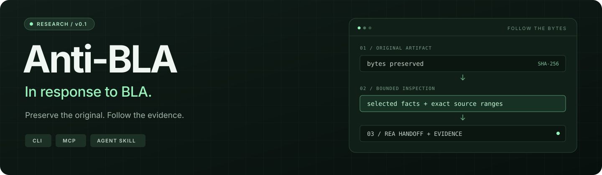

<p align="center">
  
</p>

<p align="center">
  <a href="https://github.com/juniper234/anti-bla/releases/tag/v0.1"></a>
  <a href="https://github.com/juniper234/anti-bla/actions/workflows/ci.yml"></a>
  <a href="LICENSE"></a>
  
</p>

<p align="center"><strong>A CLI, MCP server and agent skill for inspecting BLA-protected artifacts alongside <a href="https://github.com/morluto/rea">REA</a>.</strong></p>
<p align="center">
  <a href="#in-response-to-bla">Why</a> ·
  <a href="#works-with-rea">Works with REA</a> ·
  <a href="#quick-start">Quick start</a> ·
  <a href="#what-it-does">Capabilities</a> ·
  <a href="#what-the-evidence-says">Results</a> ·
  <a href="https://github.com/juniper234/anti-bla/blob/main/docs/ROADMAP.md">Roadmap</a> ·
  <a href="#mcp--agent-skill">MCP</a> ·
  <a href="#documentation">Docs</a>
</p>

## In response to BLA

[BLA](https://github.com/qybaihe/bla) adds obfuscation, decoys and analysis-exhaustion payloads to artifacts. Anti-BLA is a practical response: keep the original bytes intact, inspect a bounded part of the artifact, and attach evidence to the result.

Use it to recover selected JavaScript facts, navigate amplified ASAR headers, inspect native and data structures, and prepare inspection views for [REA](https://github.com/morluto/rea). Original hashes, source ranges, assumptions and incomplete results stay visible.

**v0.1 is a research preview.** Recovery claims apply to the measured tasks. A parser limit, an embedded claim or a successful inspection does not establish complete semantic recovery.

## Works with REA

Anti-BLA is a companion to [REA — Reverse Engineer Anything](https://github.com/morluto/rea) by [morluto](https://github.com/morluto). REA provides the broader reverse-engineering tools; Anti-BLA adds bounded inspection and evidence for selected BLA-protected artifacts. Your agent can use both together.

1. Install REA using its [official setup guide](https://github.com/morluto/rea#quick-start).
2. Add Anti-BLA's MCP server and agent skill using the [setup below](#mcp--agent-skill).
3. Inspect the artifact with Anti-BLA, then pass a verified [inspection view](docs/SIDECARS.md) to REA when needed.

The v0.1 handoff was verified against **REA 6.8.0**, pinned to [`317bf3f`](https://github.com/morluto/rea/tree/317bf3fe235e655b2d752d3be261cc0da7d00f2b). See the [measured results](#what-the-evidence-says) for the tested scope.

## Quick start

Requires **Node.js 24.16+**. REA is installed separately; the research comparison used its supported Node.js 24.22.1 runtime.

```sh
git clone --branch v0.1 https://github.com/juniper234/anti-bla.git
cd anti-bla
npm ci --ignore-scripts
npm run build
node dist/cli.js --help
```

Inspect the included benign example without executing it:

```sh
node dist/cli.js inspect-javascript examples/routes.mjs --root examples --entry-export register --section facts
```

Point an operation at your own artifact with an explicit allowed directory:

```sh
node dist/cli.js inspect-artifact /path/to/app.asar --root /path/to
node dist/cli.js inspect-asar /path/to/app.asar --root /path/to --limit 20
node dist/cli.js read-asar-entry /path/to/app.asar --root /path/to --member-path package.json --length 1024
```

Precompiled packages are available from the [v0.1 release](https://github.com/juniper234/anti-bla/releases/tag/v0.1). Install the downloaded tarball into a directory you own:

```sh
npm install --prefix ./anti-bla-tool ./anti-bla-0.1.0.tgz --ignore-scripts --omit=dev
node ./anti-bla-tool/node_modules/anti-bla/dist/cli.js --help
```

## What it does

| Capability | What you get |
| :--- | :--- |
| **JavaScript / TypeScript** | Selected export roots, conservative primitive and predicate facts, digest proofs, explicit unknowns and inspection-only normalization. |
| **ASAR** | Bounded header admission, indexed member selection and exact packed bytes with original coordinates. |
| **Native binaries** | Conservative ELF, PE and Mach-O mappings, entrypoint coordinates and bounded metadata observations. |
| **WASM / SQLite / models** | Selected code/type bytes, physical stored fields and tensor data with format-specific validity boundaries. |
| **Artifact provenance** | SHA-256, byte-addressed views, untrusted-content labels and reproducible evidence identities. |
| **REA handoff** | Optional bounded JavaScript sidecars, fixed filenames for each loader, exclusive creation and verifiable completion evidence. |

Default clients are **read-only**. Inputs are inspected statically; target imports, getters, functions and build hooks are never executed by the companion.

<details>
<summary><strong>Available MCP operations</strong></summary>

| Operation | Selection |
| :--- | :--- |
| `capabilities` | Effective limits and advertised operations |
| `inspect_artifact` | Identity, format and bounded metadata candidates |
| `read_artifact_view` | Original byte offset and length |
| `inspect_asar` / `read_asar_entry` | Bounded listing or a named packed member |
| `inspect_javascript` | Export, facts, roots, effects, unknowns or digest proofs |
| `read_normalized_javascript` | Bounded derivative bytes and change-map identity |
| `inspect_native` | Native structure and executable ranges |
| `inspect_wasm` | Export, signature and selected body bytes |
| `inspect_sqlite` | Table and physical stored fields |
| `inspect_model` | Tensor selection and stored values |
| `prepare_javascript_view` | Optional; requires an explicit existing workspace |

CLI operation names use hyphens: `inspect-javascript`, `read-asar-entry`, etc. Use bare `--help` and discover the configured operation set with `capabilities --root <directory>`.

</details>

## What the evidence says

The research pins are [BLA 1.5.1 / `b2d6436`](https://github.com/qybaihe/bla/tree/b2d643600774d62e562081129e55b13b0d9e8a80) and [REA 6.8.0 / `317bf3f`](https://github.com/morluto/rea/tree/317bf3fe235e655b2d752d3be261cc0da7d00f2b). The source inventory covers **51/51 shield files**. Inventory coverage is distinct from recovery coverage.

| Experiment | Observed outcome |
| :--- | :--- |
| Selected JavaScript call task | **12 tool-pipeline recovery improvements** across three seeds and four BLA intensities; 400 contained business checks. |
| Fresh-agent comparison | All three lanes—clean + REA, protected + REA, protected + Anti-BLA + REA—completed their selected tasks. **No incremental agent recovery win was established.** |
| Amplified ASAR headers | Documented admission and bounded member reads recover exact packed bytes; application semantics remain a separate question. |
| Genuine Electron | Real fuse hardening is distinguished from appended fake wires. Known-range byte views recover the real wire with an explicit input allowance; runtime enforcement remains unverified. |
| Genuine Flutter AOT | Targeted snapshot metadata succeeds in **3/3** builds. Exact typed labels are **2/3**; the third remains `UNKNOWN`. |
| Other formats | Several existing REA or official-tool baselines already succeed. Those outcomes stay baseline successes. |

The initial research workspace passed 348 tests and received independent code, security and evidence reviews. This public release separates **326 portable tests** from **22 opt-in research tests** that require the original providers and retained raw evidence. Public validation details are recorded in the [release summary](reports/v0.1-summary.json).

Read the [coverage matrix](docs/COVERAGE.md) for partial results, damaged GGUF assumptions, source-map information loss, default size refusals, unmeasured memory/cost and other `UNKNOWN` boundaries. The [research notes](docs/RESEARCH.md) explain provenance and reproduction.

## MCP + agent skill

Generate a concrete configuration for your client:

```sh
node dist/cli.js setup --root /absolute/path/to/artifacts --dry-run
```

This returns absolute server and skill paths. It writes no client settings. The stdio command is:

```sh
node dist/cli.js serve --root /absolute/path/to/artifacts
```

The package includes local Codex and Claude plugin manifests plus [the agent skill](skills/anti-bla/SKILL.md). A trusted client can set `ANTI_BLA_ARTIFACT_ROOT` for the plugin launcher; its fallback is the client's trusted working directory. Explicit roots make the scope easiest to review.

For inspection sidecars, supply an existing directory you own:

```sh
node dist/cli.js prepare-javascript-view /path/to/app.mjs --root /path/to --workspace /path/to/views --entry-export register
```

Require a successful response, complete evidence and matching view/evidence hashes before handing the returned directory to REA. Interrupted or uncertain outputs remain `UNKNOWN`. Follow the [sidecar contract](docs/SIDECARS.md); inspection files are never executable-equivalence claims.

## Bounds you can see

| Default | Bound |
| :--- | :--- |
| Input | 64 MiB; validated overrides have a 256 MiB hard ceiling |
| Result JSON | 64 KiB; separate MCP wire-frame enforcement |
| Raw byte view | 4,096 bytes |
| Request deadline | 5 seconds |
| Worker old-generation heap | 128 MiB |
| Active analyses | One per service |

Adapters retain their own structural caps. Worker heap limits do not bound total process RSS, and filesystem identity checks do not provide an OS sandbox against hostile concurrent writers. `ok` means the stated bounded operation completed; incomplete coverage and equivalence remain separate. CLI exit codes are `0` for `ok`, `3` for `unknown`, and `2` for `error`.

## Development

```sh
npm test                 # portable source suite; no research checkout required
npm run test:research    # explicit provider/evidence prerequisites
```

The research suite fails explicitly when its prerequisites are absent. Missing providers and excluded research tests never count as passed. Controlled dynamic research fixtures run only in disposable containers; the shipped companion performs static inspection.

## Documentation

| Guide | Contents |
| :--- | :--- |
| [Coverage](docs/COVERAGE.md) | Measured outcomes and unresolved scope |
| [Research notes](docs/RESEARCH.md) | Pins, test separation, reproduction and evidence handling |
| [Development roadmap](https://github.com/juniper234/anti-bla/blob/main/docs/ROADMAP.md) | Planned milestones, architecture, implementation tasks and release gates |
| [Shield inventory](docs/SHIELD-INVENTORY.md) | All 51 BLA modules and their source references |
| [JavaScript](docs/JAVASCRIPT.md) · [ASAR](docs/ASAR.md) | Inspection APIs and recovery boundaries |
| [Native](docs/NATIVE.md) · [Data formats](docs/DATA-FORMATS.md) | Structural views and selected data tasks |
| [Genuine frameworks](docs/GENUINE-FRAMEWORKS.md) | Electron and Flutter qualification |
| [Sidecars](docs/SIDECARS.md) | Explicit workspace, completion and handoff rules |

---

MIT licensed. See [LICENSE](LICENSE) and [third-party notices](THIRD_PARTY_NOTICES.md).
