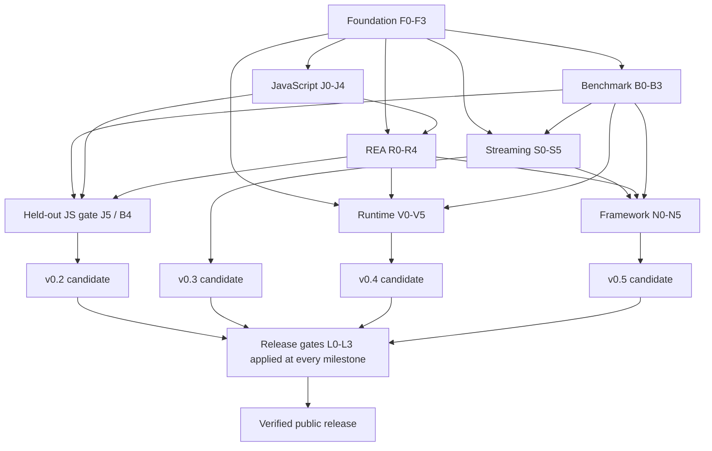

# Comprehensive REA Recovery Implementation Plan

> **For agentic workers:** REQUIRED SUB-SKILL: Use superpowers:subagent-driven-development (recommended) or superpowers:executing-plans to implement this plan task-by-task. Steps use checkbox (`- [ ]`) syntax for tracking.

**Goal:** Deliver all six recovery workstreams as tested, independently reviewed Anti-BLA capabilities with truthful REA integration and release evidence.

**Architecture:** Keep the static companion and existing APIs. Add shared proof/evidence infrastructure, a narrowly configured REA controller, metered range readers, separate contained research tools and version-specific framework adapters. Release working milestones rather than bundling speculative research into one success claim.

**Tech Stack:** TypeScript/NodeNext, Node.js, Babel, Zod, MCP SDK, node:test, existing REA/Ghidra/JADX/Frida providers, and optional digest-pinned disposable research containers.

**Spec:** [Comprehensive recovery design](../specs/2026-10-30-comprehensive-recovery-design.md). Read it and the selected subplan before implementation.

## Global Constraints

- Keep Node.js `>=24.16.0` for the existing product. Initial REA integration uses a separately admitted Node.js `24.22.1` runtime.
- Existing `anti-bla.result/1`, `status: ok|unknown|error`, CLI exits 0/3/2, and `behavioralEquivalence: unknown` remain compatible.
- Default product operations parse inert bytes only and create no files. Inspection exports require an explicitly configured existing workspace.
- Artifact content cannot select commands, profiles, packages, network destinations or judge rules.
- Missing prerequisites and excluded research tests never count as passes.
- No AI/co-author attribution in commits or release text. Raw traces, credentials, local paths and downloads stay out of Git.
- The design's canonical interfaces/resource table governs every subplan; profile changes require a documented design decision and revalidation.

## Review Focus

1. Correct value with hidden constructor/getter/throw effects: J0/J2/J3 must preserve the effect or refuse the rewrite.
2. A retained ID from another service or expired CLI session: F1/F2 must return unavailable without recomputation.
3. Partial range hash presented as a full artifact hash: S0/S5/R2 must reject full-identity handoff.
4. Runtime result arrives after cancellation or incomplete cleanup: R3/V1 must retain ownership and unknown status.
5. A correct-looking answer from unrelated bait or leaked judge files: B1/B3/J5/N5 must reject it.

## Starting point and current status

All tasks below are **PLANNED**; none is marked implemented by this document. The starting public source is `75d18499c2fd3ec197301c449c9eb7e07eaaa818`. Existing v0.1 evidence and release assets remain immutable. This planning commit adds documentation, not new advertised recovery capabilities.

The [execution manifest](2026-10-30-rea-recovery/execution-manifest.json) lists all 43 task IDs, documents and dependencies for mechanical validation/resume. It is a planning index, not a replacement for the task's acceptance tests. B4 and L0-L3 are repeated for each milestone/candidate; prior completion does not waive a new release's gates.

Use the current checkout if clean and suitable; no new worktree is needed just to execute an already isolated project. If parallel implementation needs isolation, use managed worktrees and unique task ownership. Keep shared `src/contracts.ts`, service/worker/server/CLI wiring, package files and release metadata under one integrator.

## Workstream plans and file responsibilities

| Plan | Main responsibility |
| --- | --- |
| [00 Foundation and evidence](2026-10-30-rea-recovery/00-foundation-and-evidence.md) | Shared types/policies, retained pages, service routing and compatibility |
| [01 Blind benchmarks](2026-10-30-rea-recovery/01-blind-benchmarks.md) | Sealed fixtures/judges, real lane isolation, paired scoring and metrics |
| [02 JavaScript recovery](2026-10-30-rea-recovery/02-javascript-recovery.md) | Effects, project resolution, summaries/slices and multi-file inspection views |
| [03 REA orchestration](2026-10-30-rea-recovery/03-rea-orchestration.md) | Trusted profile, bounded MCP bridge, escalation and cleanup |
| [04 Streaming formats](2026-10-30-rea-recovery/04-streaming-formats.md) | ArtifactSource, ASAR/native/Bun/data readers and large-file qualification |
| [05 Runtime validation](2026-10-30-rea-recovery/05-runtime-validation.md) | Effective containment, actual collector adapters, differential checks and stress |
| [06 Framework recovery](2026-10-30-rea-recovery/06-framework-recovery.md) | Genuine artifact prerequisites, Flutter, Unity IL2CPP and JNI profiles |
| [07 Release and compatibility](2026-10-30-rea-recovery/07-release-and-compatibility.md) | Clean package/matrix checks, evidence gates, independent review and GitHub publication |

New files have one owning task. Existing pure parsers retain their exports; wrappers adapt storage rather than rewriting every parser and semantic rule simultaneously. Existing tests under `test/` remain regression controls. New providers belong in optional adapters rather than the default dependency/install path.

## Dependency order

This graph is a workstream overview. The exact task dependencies below decide dispatch; a release gate runs for each candidate, rather than waiting until v0.5.

| Task | Deliverable | Required predecessors |
| --- | --- | --- |
| F0 | Baseline and canonical contracts/policies | None |
| F1 | Bounded retained evidence and worker framing | F0 |
| F2 | Product schemas, CLI/MCP view lifetime and capability wiring | F1 |
| F3 | Compatibility/lifecycle/fingerprint controls | F2 |
| B0 | Frozen task/judge/fixture manifest contracts | F0 |
| B1 | Enforced lane isolation and prerequisite admission | B0 |
| B2 | Paired tool/agent runner and measured counters | B1, F2 |
| B3 | Exact judge, statistics and sanitized evidence export | B2 |
| B4 | Sealed holdouts and milestone scoring gates | B3; relevant implementation tasks |
| J0 | Complete conservative effect accounting | F0 |
| J1 | Authorized project inventory and static resolution | F1, J0 |
| J2 | Interprocedural summaries and bounded graph | J1 |
| J3 | Feature slices, proof records and safe rewrites | J2 |
| J4 | Multi-file exclusive inspection export | J3, F2 |
| J5 | Genuine protected/held-out semantic qualification | J4, B3, R4 |
| R0 | Trusted REA runtime/profile admission | F0 |
| R1 | Owned bounded stdio MCP bridge | R0, F1 |
| R2 | Two-attempt recovery controller | R1, J4 |
| R3 | Cancellation, process ownership and quarantine | R2 |
| R4 | Public integration/discovery and real REA tests | R3, F3 |
| R5 | Separate static native/Dart/IL2CPP/JNI provider bridge | R4, S1, N0 |
| S0 | Metered ArtifactSource and range identities | F0 |
| S1 | Streaming native mappings/Electron coordinates | S0 |
| S2 | Streaming ASAR index/member reads | S0 |
| S3 | Bun graph admission and selected module views | S1, S2 |
| S4 | Bplist feasibility/candidates and model range reads | S0, S2 |
| S5 | Genuine large-artifact, RSS and handoff qualification | S1-S4, B3, R4 |
| V0 | Independent scenario/profile manifests and preflight | F0, B0 |
| V1 | Race-safe owned container lifecycle | V0, B1 |
| V2 | Real REA runtime/capture/reconciliation adapters | V1, R1 |
| V3 | Typed finite-behavior differential judge | V2, B3 |
| V4 | Actual collector saturation/loss-accounting tests | V2 |
| V5 | Independent runtime qualification | V3, V4 |
| N0 | Genuine toolchain/build-pair prerequisite gates | F0, B0 |
| N1 | Pinned Flutter layout and object decoding feasibility | N0, S1 |
| N2 | Flutter typed facts/code/provider handoff | N1, R5 |
| N3 | Unity metadata/binary matching and method seeds | N0, S1, R5 |
| N4 | Android JNI declaration/library/function linkage | N0, S1, R5 |
| N5 | Genuine held-out framework qualification | N2-N4, B3; V5 only for runtime claims |
| L0 | Clean locked package and distribution checks | F3; relevant completed workstream |
| L1 | Compatibility matrices and independent review | L0 |
| L2 | Release evidence and support-matrix gate | L1, B4; relevant J5/S5/V5/N5 |
| L3 | Version/tag/assets/GitHub verification | L2 |

## Release slices and objective exit gates

**M0 — engineering foundation.** F0-F3 and B0-B3 deliver usable internal controls. Re-run the 326-test portable baseline before product work; retain the explicit 22-test research separation. Do not advertise new recovery from this milestone alone.

**M1 — proposed v0.2.0.** Complete J0-J5, R0-R4 and the JavaScript B4 cohort. Tool-pipeline benefit and fresh-agent benefit are separate gates. An agent-benefit claim requires at least one predeclared feature-task family to improve across three independent held-out seeds in the registered fresh-agent cohort: clean+REA correct, eligible protected+REA incorrect/unknown, Anti+REA correct, with no confident incorrect answers in the release controls. Provider/isolation/meter/judge/cleanup failures are ineligible comparisons, not wins; publish all scheduled outcomes and eligible denominators. If no added agent benefit is established, ship only clearly labelled tooling/experimental improvements after a scope decision; do not claim the recovery objective is complete.

**M2 — proposed v0.3.0.** Complete S0-S5 and corresponding B4 tasks. Large genuine Bun/Electron/ASAR fixtures return exact selected bytes/ranges within the declared accounting and measured container-memory target. Native/Bun/ASAR/model/bplist facets have separate support entries. Conditional bplist reconstruction remains conditional; failure of its feasibility gate cannot become a repaired-original claim.

**M3 — proposed v0.4.0.** Complete V0-V5. Effective containment is proven before launch; actual REA captures withstand declared stress with correct loss/unknown accounting; finite business observations and cleanup are independently checked. Product default discovery still advertises no target execution.

**M4 — proposed v0.5.0.** Complete qualified N0-N5 profile entries. Flutter requires typed objects/code attribution beyond string presence; Unity requires a genuine matching pair; JNI requires declaration/library/code linkage. All three are required to mark the full framework milestone complete. Individual profiles can be released earlier with explicit unsupported entries for the others. Any runtime claim also needs V5 on the matching platform/profile.

**Every candidate:** run L0-L3. A new release never moves `v0.1`, overwrites old benchmark records or reuses a digest from a different package. A final broad release number is chosen only after the support matrix is real.

## Execution protocol

- [ ] Read this design, the selected subplan, local `AGENTS.md` and relevant existing source/tests. Claim one task and record the exact base commit in local coordination records.
- [ ] Freeze its consuming/producing interfaces. If changing a shared contract, update the design and dependent task descriptions first; do not let separate workers invent competing types.
- [ ] Add decisive failing behavior/adversarial tests; run the focused command and preserve the failure. Implement the smallest supported behavior; run the focused command again.
- [ ] Review the diff against the task's acceptance, provenance and budget rules. Obtain fresh independent review for semantic/format/lifecycle boundaries; fix Important/Critical findings with reproduced controls.
- [ ] Commit one reviewable deliverable with user-only attribution. Update task status with commit/test/review references. Do not mark research qualification complete from mock tests.
- [ ] At a milestone, run the full portable suite, explicit provider suites, sealed holdout and release checklist. Record failures and unmeasured fields. Publish only the scope the evidence supports.

Parallel work: after F0, benchmark contracts, effects, range-source infrastructure and framework prerequisite inventory can proceed independently. Shared service/worker/schema/CLI edits remain serialized under the integrator. No worker may run a hidden cohort whose judge it has read. Do not spawn many implementation contexts merely to duplicate one task.

Routine authorized fixes, local tool installation and reversible environment recovery can proceed. Credential access, spending, genuinely destructive operations and substantially new scope still follow the operator's standing rules. Existing GitHub publication authorization covers this project's reviewed planning/source/release pushes; it does not authorize sending messages to others or publishing private raw evidence.

## Resume state and completion ledger

Use a local task ledger with `taskId`, `state`, `baseCommit`, `commit`, `commands`, `review`, `qualification`, `blocker`, `nextAction`. States: planned, active, implemented, reviewed, qualified, blocked, released. A dependency requires the state its task specifies; a feasibility spike that found unsupported behavior is recorded but does not unlock a genuine-qualification gate.

Start execution with **F0 and B0**, then **J0/S0/R0** after the required contracts freeze. The planning commit is complete when links, task dependencies, interface consistency, privacy and source references have been checked and the documents match the remote GitHub files. It does not satisfy any implementation checkbox.
